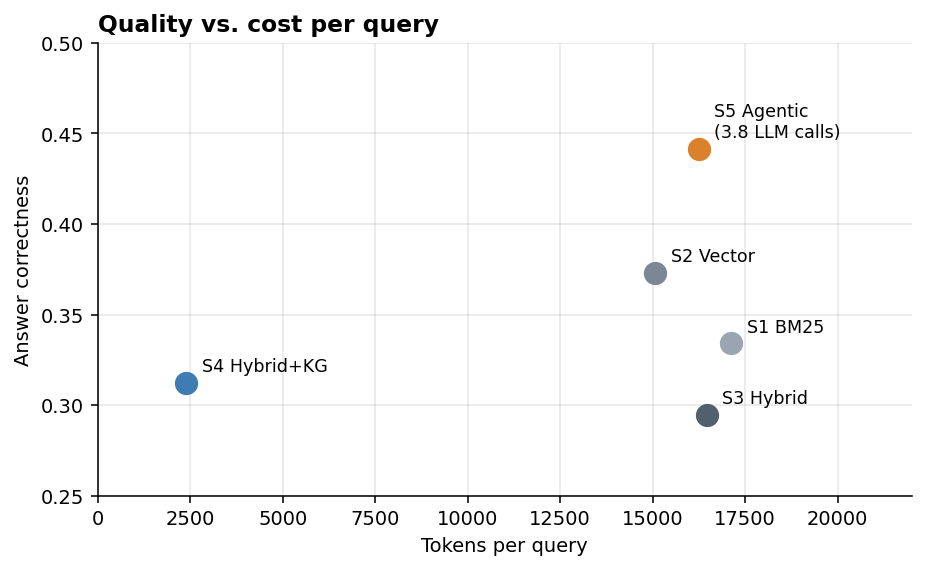
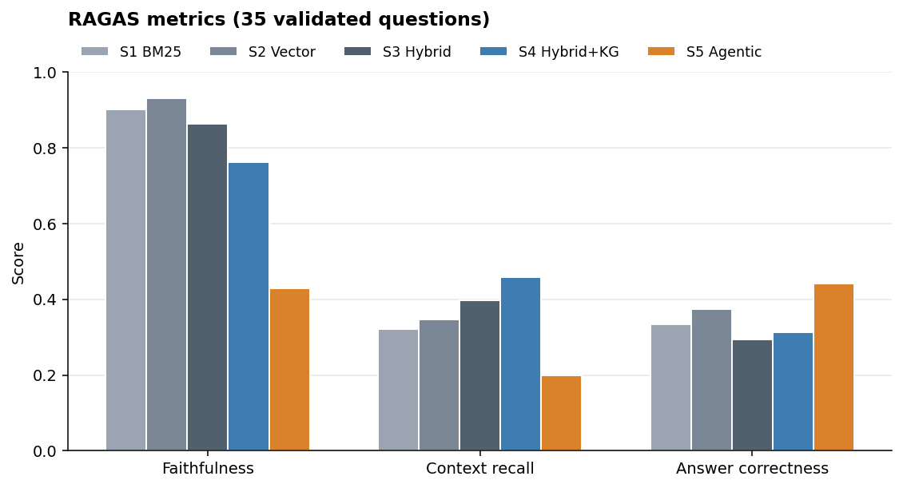
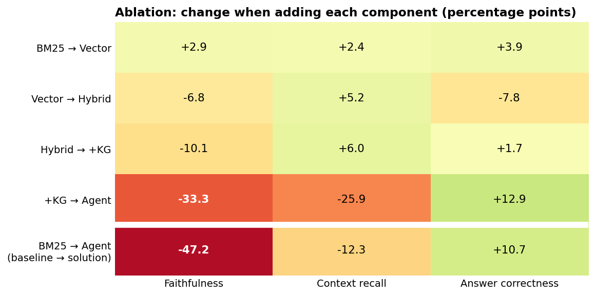
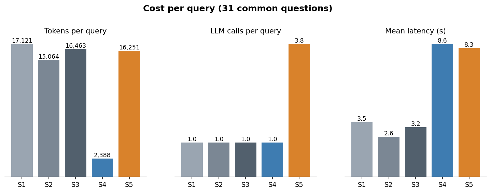

# RAG and Agentic RAG for financial questions over SEC filings

Ablation study of five RAG architectures, from BM25 to a LangGraph agent, over 10-K and 10-Q filings of 10 Nasdaq-100 companies. Each system adds one component to the previous one, and all of them are evaluated with the same 35 questions, the same metrics (RAGAS) and the same cost measure.

📄 **Paper:** [`paper/paper_ieee.pdf`](paper/paper_ieee.pdf)  · 📓 **Notebook:** [`project.ipynb`](project.ipynb)

## Results

<p align="center">
  
</p>

| System | Faithfulness | Context recall | Answer correctness | Tokens / query | LLM calls | Latency |
|---|---|---|---|---|---|---|
| S1 BM25 (baseline) | 0.901 | 0.322 | 0.334 | 17,121 | 1 | 3.5 s |
| S2 Vector | **0.930** | 0.346 | 0.373 | 15,064 | 1 | 2.6 s |
| S3 Hybrid (RRF) | 0.863 | 0.398 | 0.295 | 16,463 | 1 | 3.2 s |
| S4 Hybrid + Knowledge Graph | 0.762 | **0.458** | 0.312 | **2,388** | 1 | 8.6 s |
| S5 Agentic (LangGraph) | 0.429 | 0.199 | **0.441** | 16,251 | 3.84 | 8.3 s |

- The agent gets the highest *answer correctness* (+10.7 points over BM25) with a similar token volume, but with almost 4 LLM calls and higher latency.
- Hybrid fusion and the knowledge graph improve retrieval, but not the final answer.
- The agent's low *faithfulness* is largely explained by how it is evaluated: RAGAS does not see the calculator results and receives truncated previews of each search.

### Quality (RAGAS)

<p align="center">
  
</p>

### Ablation

Change in each metric when a component is added. The last row compares the baseline (BM25) with the solution (agent).

<p align="center">
  
</p>

### Cost

<p align="center">
  
</p>

The full analysis, including the limits of the experiment, is in the paper. The figures above are regenerated with `python assets/make_figures.py`.

## Systems

| System | Retrieval | Context sent to the LLM | LLM |
|---|---|---|---|
| S1 BM25 | BM25 (Okapi), top-8 | full chunks | gpt-4o-mini |
| S2 Vector | BGE-M3 + FAISS, top-8 | full chunks | gpt-4o-mini |
| S3 Hybrid | S1 + S2 with Reciprocal Rank Fusion (k=60) | full chunks | gpt-4o-mini |
| S4 Hybrid+KG | S3 + knowledge graph subgraph | chunks of 1000 characters + 5 entities and 5 relations | gpt-4o-mini |
| S5 Agentic | ReAct agent (LangGraph) with `search`, `get_financial_facts` (XBRL) and `calculator` | 15 previews of 800 characters per search | GLM-5.3-Flash |

## Structure

```
├── project.ipynb              # Main notebook: data, systems, evaluation, costs and conclusions
├── paper/                     # IEEE-format paper (LaTeX, PDF and figures)
├── assets/                    # README figures and the script that generates them
├── run_evaluation.py          # Runs the 5 systems over the evaluation questions
├── estimate_costs.py          # Tokens, LLM calls, latency and USD per system
├── src/
│   ├── ingestion/             # SEC EDGAR download and HTML normalization
│   ├── retrieval/             # Chunking, BGE-M3 embeddings, BM25/FAISS indexes and hybrid search
│   ├── knowledge_graph/       # Entity/relation extraction and graph construction
│   ├── llm/                   # Client for OpenAI-compatible endpoints
│   ├── tools/                 # Agent tools (search, calculator, get_financial_facts)
│   └── systems/               # Systems S1–S5
└── data/
    ├── universe.csv           # The 10 companies of the study
    ├── chunks/                # Chunked corpus (6,536 chunks)
    ├── manifests/             # Document inventory per company
    ├── company_facts/         # XBRL data used by get_financial_facts
    ├── knowledge_graph/       # Extracted entities and relations (the graph is rebuilt from them)
    └── evaluation/            # Validated questions, answers of the 5 systems, RAGAS scores and costs
```

The original SEC HTML files (`data/raw/`), the normalized documents (`data/processed/`), the embeddings and the indexes are not included because of their size; they are regenerated with the pipeline.

## Installation

```bash
python -m venv .venv && source .venv/bin/activate
pip install -r requirements.txt
cp .env.example .env   # fill in OPENAI_API_KEY, GLM_BASE_URL and SEC_USER_AGENT
```

## Usage

The notebook runs end to end with the results included in `data/evaluation/`:

```bash
jupyter notebook project.ipynb
```

To rebuild the full pipeline (run every command from the project root):

```bash
# 1. Corpus
python -m src.ingestion.download_all          # downloads 10-K and 10-Q from SEC EDGAR
python -m src.ingestion.process_documents     # HTML → text normalized by section
python -m src.retrieval.process_chunks        # chunking

# 2. Indexes
python -m src.retrieval.generate_embeddings   # BGE-M3 embeddings (a GPU is recommended)
python -m src.retrieval.bm25_index
python -m src.retrieval.faiss_index

# 3. Knowledge graph (the graph itself is rebuilt on load from entities/relations)
python -m src.knowledge_graph.entity_extractor   # optional: data/knowledge_graph already has the output
python -m src.knowledge_graph.graph_builder

# 4. Evaluation
python run_evaluation.py                      # 5 systems × 35 questions
python estimate_costs.py
```

### LLM configuration

S1–S3 and the entity extraction use an OpenAI-compatible client configured with `OPENAI_API_KEY` (optionally `OPENAI_BASE_URL` and `LLM_MODEL`, default `gpt-4o-mini`). S4 and the S5 agent talk to a self-hosted OpenAI-compatible endpoint (GLM-5.3-Flash in the original experiments), configured with `GLM_BASE_URL`, `GLM_API_KEY` and `GLM_MODEL`. See [`.env.example`](.env.example) and `src/llm/llm_client.py`. The query embedder uses CUDA when available; set `EMBEDDER_DEVICE` to choose another device.

## Data

The filings come from [SEC EDGAR](https://www.sec.gov/edgar) and are in the public domain. The SEC requires an identifying User-Agent that includes a contact email (`SEC_USER_AGENT` in `.env`) and limits downloads to 10 requests per second.

## Author

Fernando José Soto Jácome · MSc in Artificial Intelligence, Universidad San Francisco de Quito (USFQ)
